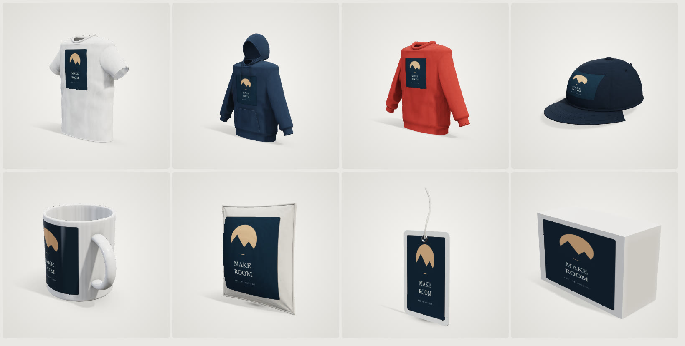
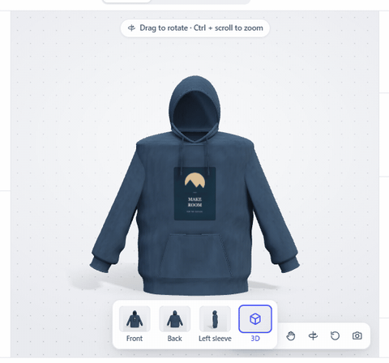
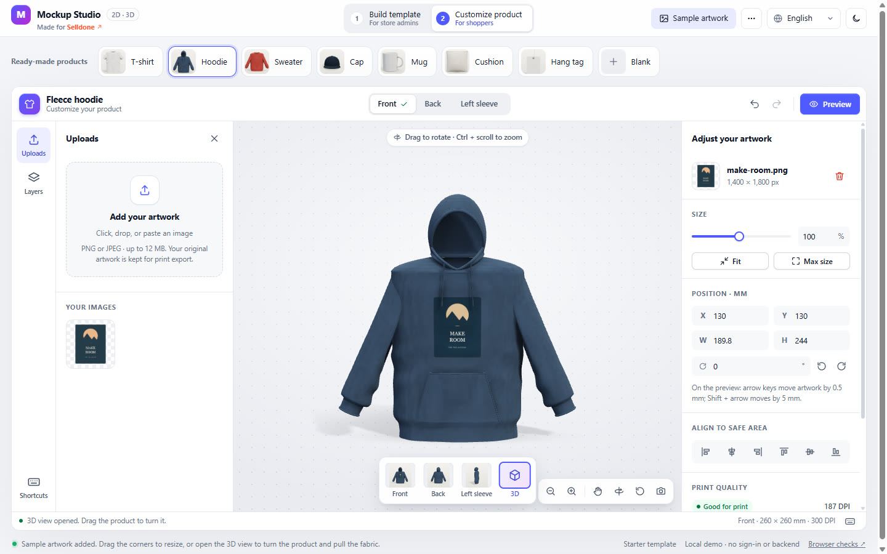
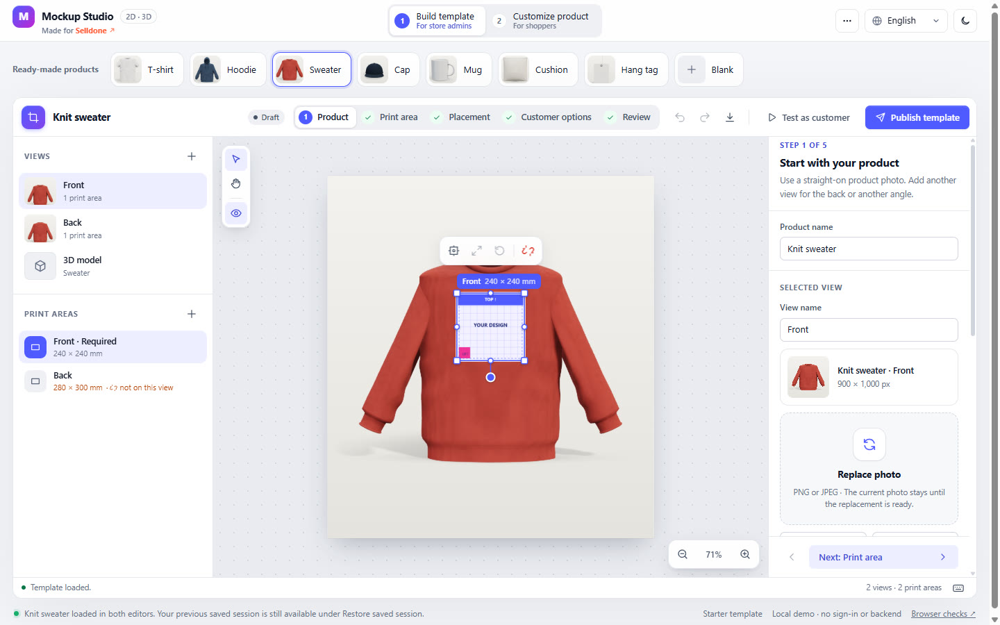
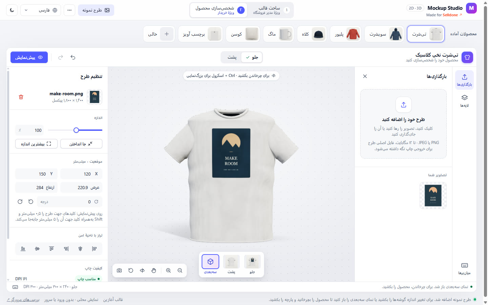
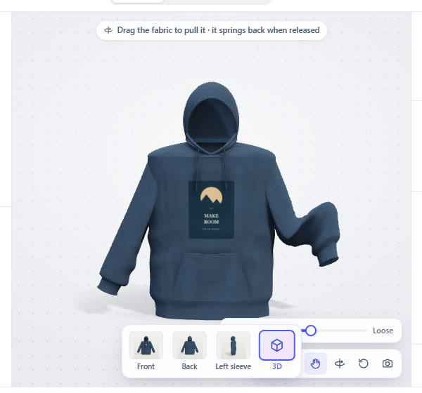
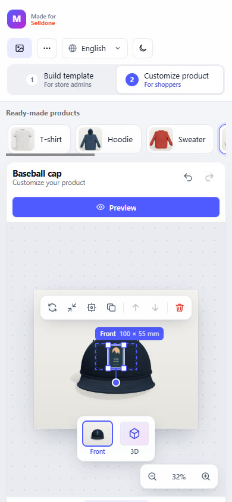

<div align="center">

<a href="https://modern-shop.github.io/mockup-designer-tools/"></a>

# 👕 Mockup Studio · Print-on-Demand Product Designer

**Store admins turn a product into a print template. Shoppers drop in their artwork, see it on a 3D product they can spin and tug, and hand over a print-ready file.**<br>
A concept store from **Modern Shop**, made for [Selldone](https://selldone.com).

[](https://selldone.com)
[](https://modern-shop.github.io/mockup-designer-tools/)
[](#%EF%B8%8F-build-it-for-real-with-selldone)

[](https://www.typescriptlang.org)
[](https://vite.dev)
[](#-the-3d-engine)
[](#-embed-it)
[](#-the-3d-engine)
[%20%7C%20Deutsch-6e5546?style=flat-square)](#-features)
[](https://github.com/modern-shop/mockup-designer-tools/actions/workflows/deploy.yml)
[](LICENSE)
[](CONTRIBUTING.md)
[](https://claude.com)

[**Live demo**](https://modern-shop.github.io/mockup-designer-tools/) ·
[**Integration guide**](docs/INTEGRATION.md) ·
[**More concept stores**](https://github.com/modern-shop)



</div>

---

## ✨ Features

| | |
|---|---|
| 🧑‍💼 **Two editors, two audiences** | **Build template** is for store admins: product photos, print areas in millimeters and DPI, placement, what shoppers may change, publish. **Customize product** is for shoppers: upload, drag, resize, rotate, preview, done. |
| 🧊 **Realistic 3D preview** | T-shirt, hoodie, sweater, cap, mug, cushion, hang tag and box, generated in code: sleeves sewn along the body, ribbed collars, cuffs and waistbands, seams and topstitching, a woven neck label, studio lighting with soft shadows, and cotton, fleece, knit, twill, linen and glaze surfaces. Or bring your own GLB. |
| 🍮 **Pull the fabric** | Grab a sleeve and lift it: the fabric gives like jelly and springs back. A **Stiff / Loose** slider sets how soft it is. Mugs, boxes and tags stay rigid. |
| 📸 **Photos from 3D** | One click renders studio product photos for every print area, with the print area already placed, so a new product needs no photo shoot to get started. |
| 🛍️ **Ready-made products** | Pick a product and it loads into both editors at once: an editable draft for the admin, the published product for the shopper. |
| 🖨️ **Print truth** | Artwork lives in physical millimeters. The print PNG carries DPI, bleed and transparency and is separate from the preview; a live meter reports real print quality. |
| 🧱 **Embeds anywhere** | Framework-free Shadow DOM components with no global CSS, several instances per page, typed events and adapters. The shopper bundle never downloads admin or 3D code until it is used. |
| 🌍 **English, فارسی, Deutsch** | Complete catalogs, right-to-left layout that never mirrors artwork, localized units and plurals, light and dark themes, touch and keyboard. |

## 📸 Screenshots

<table>
  <tr>
    <td></td>
    <td></td>
  </tr>
  <tr>
    <td align="center"><sub>Shoppers customize and turn the product in 3D</sub></td>
    <td align="center"><sub>Store admins build the template</sub></td>
  </tr>
  <tr>
    <td></td>
    <td align="center"> </td>
  </tr>
  <tr>
    <td align="center"><sub>فارسی, right to left</sub></td>
    <td align="center"><sub>Pull the fabric · phone layout</sub></td>
  </tr>
</table>

## 🚀 Quick start

```bash
git clone https://github.com/modern-shop/mockup-designer-tools.git
cd mockup-designer-tools
npm ci
npm run dev            # http://127.0.0.1:5173
```

| Script | What it does |
|---|---|
| `npm run dev` | Dev server with hot reload |
| `npm run check` | Type-check |
| `npm test` | Build the library and run the unit tests |
| `npm run build` | Type-check, build the demo to `dist/` and the library to `dist/lib/` |
| `npm run preview` | Serve the production build |

Requires Node.js 22.12 or newer (verified with 22.14). The 3D view needs a WebGL 2 browser; every 2D editing feature works without it.

## 🧭 Using the demo

The header's two modes say who they are for: **Build template** (for store admins) and **Customize product** (for shoppers). The **Ready-made products** row loads a T-shirt, hoodie, sweater, cap, mug, cushion, or hang tag into both editors at once; each has a 3D model, and its product photos are rendered from that model. **Blank** starts an empty draft. The globe dropdown switches the demo and both editors between **English**, **فارسی** (right to left), and **Deutsch** without losing work.

1. In **Build template**, follow the five-step bar: name the product and add photos (or **Create photos from 3D**), add print areas with millimeters/DPI, drag or resize the area outline on the photo, and choose customer permissions.
2. Choose **Publish template** (or **Publish & test as customer** in Review).
3. Upload, drop, or paste artwork, or use **Sample artwork** in the demo header. Drag to move, pull corner handles to resize, use the round handle to rotate, and fine-tune in the inspector. Undo/redo and keyboard shortcuts work in both editors. Choose **3D** in the view strip to turn the product: drag to rotate, Ctrl/⌘ + scroll or pinch to zoom; inspector edits update the model live. On garments, cushions and caps, the hand button (**Pull fabric**) lets you drag the fabric, for example to lift a sleeve; it springs back like jelly when released, and the **Stiff / Loose** slider changes how far it gives. Mugs are solid and cannot be pulled.
4. Choose **Preview**, then download a transparent **print PNG** or a separate **product preview PNG**, and **Use this design** to hand the snapshot to the host.
5. Use the **•••** menu to save/restore the session in browser storage or export/import its JSON, including image assets. The moon/sun button switches both editors between light and dark themes.

The demo is local: publishing creates an immutable revision in memory, and confirmation passes a snapshot to the demo host. The host application is responsible for persistent publication, authentication, commerce, and orders.

## 🧩 Embed it

```ts
import { mountCustomer } from 'mockup-designer-tools/customer';
import { downloadBlob } from 'mockup-designer-tools';

// publishedTemplate is a complete ProductTemplate, status: 'published'.
const customer = await mountCustomer(document.querySelector('#customizer')!, { template: publishedTemplate, locale: 'en', direction: 'ltr' });
customer.element.addEventListener('mdt:confirm', event => {
  const { snapshot } = (event as CustomEvent).detail; // template + design + assets, ready for your cart
});
const print = await customer.exportPrint('front');
downloadBlob(print.blob, 'front-print.png');
```

`mountAdmin` from `mockup-designer-tools/admin` mounts the template builder the same way. The [integration guide](docs/INTEGRATION.md) covers controllers, events, adapters for your storage, the document format, 3D models, localization and limits.

## 🧊 The 3D engine

- **Zero asset files, zero runtime dependencies.** Every product is generated in code and drawn by a small WebGL 2 viewer of our own. It loads only when someone opens the 3D view.
- **Garments as on an invisible mannequin.** Tapered torsos with rounded shoulders, sleeves lofted from an armhole that is laid onto the body surface (so the sleeve is sewn on, with no gap from any angle), ribbed collars, cuffs and waistbands, a hood with a face opening and drawstrings, a kangaroo pocket, drape folds from the armpits, and a woven label inside the neck.
- **Sewing detail.** Side and shoulder seams, armholes, waistband and cuff seams, and double-needle hems, pocket and cap topstitching are bump-mapped from per-vertex seam data and fade out before they could flicker.
- **Studio lighting.** A warm key softbox with soft shadow-mapped shadows (on the product and the floor), cool fill and rim lights, baked ambient occlusion on both sides of the cloth, a fabric sheen lobe, glaze reflections of the softboxes, and ACES tone mapping.
- **Fabric you can pull.** A meshless soft body (shape matching with overlapping clusters) drives the pull tool and lets loose fabric sway when the product spins; shoulders, necklines and armholes stay pinned. It is a preview effect: it never changes the design or the print.
- **Photo studio.** The same renderer photographs each printable part and projects the print area onto the photo, so 2D views can be created from the 3D model.

## ✅ What is real, and what is not yet

Real today: both editors, physical print export with DPI and bleed, versioned templates and designs, the 3D preview and pull tool, photos from 3D, three complete languages, and the test suites below. Text/font editing, variants, photo lighting overlays, perspective/curved wrapping on photos, dragging artwork directly on the 3D model, soft bodies for GLB models, cloth collision and gravity, compressed or animated glTF, provider production adapters, and a backend remain future work. Generated 3D shapes illustrate the design; they are not measured product models. Browser RGB output does not perform CMYK/ICC conversion.

## 🔬 Build and verify

```sh
npm run check
npm test
npm run build
npm run preview
```

`npm test` covers geometry, units, permissions, schema/revision validation, persistence, DOM-free imports, the editor's handle/rotation/zoom math, 3D mesh generation for every preset (finite data, printable parts with sizes and facing angles, baked occlusion, sleeves sewn onto the body, closed side seams, size scaling) and print mapping, soft-body rotation extraction, pinning, pulling and settling, the GLB reader (including truncated, out-of-range, external-resource, and cyclic files), 3D model validation, and completeness of every language catalog against the English reference. Open **tests/browser.html** (also linked from the demo footer) and choose **Run checks** for actual canvas pixels/alpha/DPI, preview mapping, clipping, real image ingestion, asset-cache regressions, hostile host CSS, multiple instances, RTL, snapshots, restore, cleanup, pointer-driven resizing with keyboard undo in both editors, a scan of both editors (including the 3D view) in Persian for untranslated text, a real WebGL render whose center pixel must show the textured artwork, and a fabric pull that must change the hoodie render without changing the design, a mug without the pull tool, and photo views created from the 3D model with the print area on the chest. Keep the page visible while they run: browsers pause image decoding in hidden tabs.

`npm run build` creates the runnable demo in `dist/` (relative paths, so it works from any folder, such as GitHub Pages) and independent ESM library modules plus TypeScript declarations in `dist/lib/`. The library's `customer` entry does not import admin code. Measured on 2026-10-22 with a minified Vite library build: the customer editor is about 164 KB minified / 47 KB gzip (its entry plus the shared editor chunk); the admin entry adds about 69 KB / 21 KB gzip only where it is loaded (it imports a 1 KB preset table, not the mesh generators); the 3D viewer, generated shapes, soft body, and GLB reader add about 90 KB / 29 KB gzip only when a 3D view is opened or photos are created; each language catalog is about 8 KB gzip and loads only when used.

## 🛍️ Build it for real with Selldone

This repository is a **concept store**: templates, designs and "orders" stay in your browser so the experience can be shown anywhere.
With [Selldone](https://selldone.com) you can sell customizable products for real, with products and variants, payments, shipping and order management.

The editors never talk to a backend themselves. The host stores what they hand over: `mdt:publish` gives the builder's published template, `mdt:confirm` gives the shopper's snapshot (template revision, design and assets), and an `assets` adapter can upload images to your storage. Connect those to your Selldone products and cart, and the editors keep working unchanged.

## 🗺️ Roadmap

- [x] Template builder and shopper editor with physical print export
- [x] Rotatable 3D preview with generated products and GLB support
- [x] Ready-made products, photos from 3D, and the fabric pull tool
- [x] English, Persian (RTL) and German
- [ ] Text and fonts
- [ ] Product variants (sizes and colors)
- [ ] Drag artwork directly on the 3D model
- [ ] Selldone product, cart and order adapter
- [ ] Lighting overlays and curved wrapping on product photos

## 📚 Documentation

| Document | Purpose |
| --- | --- |
| [Integration guide](docs/INTEGRATION.md) | Actual API, events, document conventions, 3D models, localization and limits |
| [Agent guide](AGENTS.md) | Durable requirements and constraints for contributors |
| [Product plan](docs/PRODUCT_PLAN.md) | Broader scope and delivery gates, including later work |
| [UX specification](docs/UX_SPEC.md) | Merchant/shopper workflows and accessibility expectations |
| [Architecture proposal](docs/ARCHITECTURE.md) | Architectural rationale and future design contracts |
| [Research](docs/RESEARCH.md) | Official-source product comparisons |

## 🧩 Part of Modern Shop

<a href="https://github.com/modern-shop"></a>

[**Modern Shop**](https://github.com/modern-shop) is a gallery of concept storefronts, each showing a different way to sell online.
Every one of them can be built as a working store for your business with [Selldone](https://selldone.com).
<br clear="left">

## 📄 License

[MIT](LICENSE). Use it, remix it, ship your own store.

<div align="center">
<sub>Made for <a href="https://selldone.com">Selldone</a> · Built with Claude Opus 5.5</sub>
</div>
