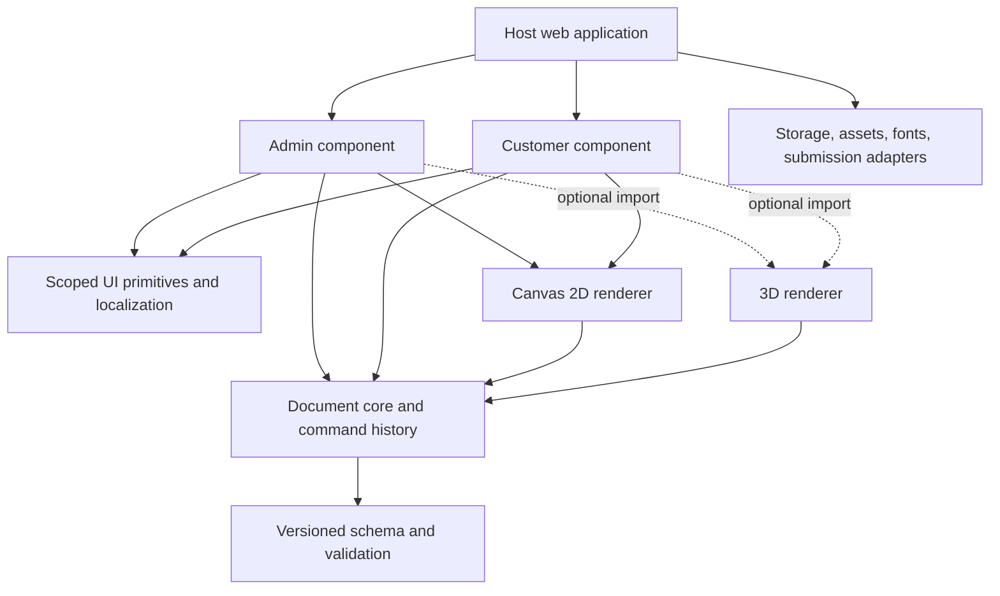

# Architecture proposal

Status: planning proposal, not an implemented API. Reviewed against primary documentation on **2026-10-22**. Product requirements in the project brief take precedence over the implementation recommendations here.

The first 2D implementation now uses the logical boundaries below in a single `src/` tree. The examples in this proposal describe future design direction; use [INTEGRATION.md](INTEGRATION.md) and exported TypeScript types for the actual v0.1 signatures and supported features.

## 1. Architectural decisions

| Decision | Proposed approach | Reason |
| --- | --- | --- |
| Product shape | One embeddable library with separate admin and customer entry points | Hosts load only the experience they need. The demo applications exercise the same library consumers will use. |
| Core | Framework-independent TypeScript, pure document operations | Reusable in Vue, React, plain JavaScript, tests, and a future server renderer. |
| UI | Custom elements with an open Shadow DOM; optional framework wrappers | Native integration and a clear style boundary, with no global UI framework dependency. |
| First renderer | Native Canvas 2D plus accessible DOM controls | Suitable for initial image/text manipulation and flat product templates; keeps the baseline dependency graph small. |
| 3D renderer | Separate, dynamically imported Three.js adapter using glTF 2.0/GLB assets | 2D users should not download or initialize a 3D engine. |
| Data | Versioned JSON documents referencing host-managed assets | Templates and customer designs survive UI or renderer changes. |
| Persistence | Host-provided asynchronous adapters | The library does not assume a storefront, cloud provider, authentication system, or cart implementation. |
| Production truth | A flat physical print surface independent of the visual mockup | Product photography, perspective, camera position, and shadows must never change the printing file. |

These are recommendations for the first implementation. They do not authorize building every proposed package now. Package names below are provisional.

## 2. Boundaries and dependency direction



The core never imports a UI framework, a browser global, Three.js, a store SDK, or an upload endpoint. Renderers consume a resolved document snapshot; they do not own the document. UI actions call validated core commands. Adapters own external side effects.

Avoid a monolithic package that imports both experiences and every renderer. Do not add React, Vue, Bootstrap, a global icon font, analytics, or a large editor framework to the baseline. Canvas 2D is a starting choice, not a rule to reimplement complex geometry forever: evaluate a focused dependency when a measured requirement justifies it, behind the renderer or geometry boundary.

## 3. Canonical documents and coordinates

Keep these concepts separate:

| Document | Contents | Ownership |
| --- | --- | --- |
| `ProductTemplate` | Surfaces, real dimensions, printable masks, view mappings, variants, permitted operations, quality rules, defaults | Merchant; published revisions are immutable |
| `DesignDocument` | Template revision reference, selected variant, customer layers, transforms, asset references | Customer session |
| `AssetManifest` | Stable asset IDs, hashes, media type, dimensions, font metadata and revision | Host storage adapter |
| `SubmissionSnapshot` | Frozen template/design revisions, asset manifest, preflight result, export metadata | Host order/submission workflow |

Every document has its own `schemaVersion`. Template identity and published revision are separate from schema version. Validate imported documents before resolving their resources. Reject unsupported major versions with a useful error; never silently drop unknown required features. Provide explicit, tested, sequential migrations for supported older versions.

### Print-surface space

Use **millimeters** for physical print surface dimensions and layer geometry. Each surface has a bounding rectangle with origin at its upper-left, positive X rightward, positive Y downward, rotation expressed clockwise in degrees. An image layer stores a center point, unrotated width/height, rotation, optional mirror flags, and a normalized source crop. A text layer additionally stores text, language/direction, a stable font asset ID, font size, line spacing and alignment. Internally, derive matrices for hit testing and drawing instead of serializing multiple competing transform representations.

The printable outline, trim, bleed and safe area are distinct geometry. A rectangular surface can contain a closed printable contour or alpha mask. Preserve vector contour data where available; an uploaded alpha mask must declare its mapping to physical dimensions. Store mask assets by reference rather than embedding large data URLs in JSON. Do not equate the product silhouette with the printable area.

For a rectangular export, nominal pixel dimensions are `round(mm / 25.4 × DPI)`. Effective raster DPI depends on the source pixels remaining after cropping and the physical placed size; scaling a preview does not create print detail. Evaluate both axes and warn on the limiting axis. The template's manufacturing profile defines required resolution and bleed; 300 DPI is an example, not a universal rule.

### Preview/view space

One surface may appear in several photos or a 3D view. Each view contains a list of surface bindings, so one product photo or model can show several print areas at once. Each binding records its surface ID, mapping, preview-only mask/occlusion references, and composition order:

- Flat photo: normalized rectangle or affine mapping into the image.
- Perspective photo: a calibrated quadrilateral, rendered through an optional perspective renderer.
- Curved photo: calibrated mesh/displacement data, implemented in a later renderer.
- 3D: a UV mapping binding a surface texture to specified mesh primitives/material slots.

View mappings are presentation data. The canonical design stays flat in print-surface space. The same front design can appear in a close-up and a lifestyle photo without duplicating customer layers. Front, back and a mug wrap are independent surfaces when they have different production files. A size variant may change physical dimensions or mappings, requiring explicit compatibility rules; never silently scale to a different manufacturing area.

Start with a simple rectangular image mapping and contour clipping. A contour clips a drawing; it does **not** automatically simulate fabric folds, perspective or mug curvature. Validate the later perspective and curved renderers independently before making realism claims.

## 4. Rendering and export pipeline

1. Validate the template/design pair and operation permissions.
2. Resolve all referenced images and fonts through the asset adapter; await decoding and font readiness.
3. Produce a renderer-neutral display list from canonical layers.
4. Render a reduced-resolution interactive surface texture.
5. Composite that texture into the selected view with product base image, mapping, optional shading and occlusion layers.
6. For export, render a separate offscreen **flat print surface** at the requested physical resolution, with permitted production layers only.
7. Return typed results and metadata; the host decides where to persist or download them.

`exportPreview()` and `exportPrintSurface()` are separate operations with different inputs and result types. Preview export includes product imagery; print export must not. Print exports include dimensions, surface ID, DPI, alpha/background policy, document hash and template revision. Reject unsupported formats explicitly. PNG is the proposed first raster output; JPEG can be an opaque preview option. PDF, CMYK/ICC conversion, separations, cut paths and vendor-specific production packages belong in optional production adapters.

Canvas rendering is not a guarantee of color-accurate physical output. A display mockup is a simulation; the manufacturing workflow must define and validate color handling. Identical document geometry should reproduce within declared tolerances; cross-browser antialiasing and font rasterization may prevent byte-identical PNGs. Use one controlled server renderer later if byte-level consistency or large manufacturing exports require it.

External images need correct CORS approval before being drawn into an exportable canvas. A tainted canvas blocks pixel reads and exports; a client-side setting cannot bypass that restriction. A properly configured host server proxy can serve permitted assets from the host's origin or with suitable CORS headers, but requires its own access checks and resource limits. Validate asset origin/credentials policy during template preparation and report an actionable asset error before checkout. [MDN: cross-origin images in canvas](https://developer.mozilla.org/en-US/docs/Web/HTML/How_to/CORS_enabled_image)

### Interaction rendering

Keep design coordinates independent from CSS pixels, device pixel ratio and viewport zoom. Render on changes rather than running a permanent animation loop. Clamp preview pixel ratio and use decoded image previews instead of full production images during dragging. Retain original assets for exports. Coalesce pointer movements into animation frames and commit one undo command at gesture end. Make worker/offscreen rendering a capability-based optimization with a main-thread fallback; correctness cannot depend on worker availability.

Large exports must preflight pixel count and estimated working memory. Do not promise a browser-independent maximum canvas size. Fail with a recoverable result if local export exceeds the configured limit; a future host production service can consume the same frozen documents. A successful preview does not imply a large export will fit in memory.

## 5. 3D is an optional rendering capability

Use glTF 2.0 with GLB as the preferred distribution container; glTF is a standardized asset format, not a file that browsers render without an engine. glTF provides meshes, materials and texture coordinates. A renderer such as Three.js loads and displays the asset. [Khronos glTF registry](https://registry.khronos.org/glTF/), [Three.js GLTFLoader](https://threejs.org/docs/pages/GLTFLoader.html)

Require prepared, UV-unwrapped product assets. Assign stable application IDs to relevant primitives and material bindings; names alone are not reliable identifiers. Record atlas bounds, orientation, mapping version and the originating print surface. Reject required unsupported glTF extensions and unresolved external resources at import. Prefer self-contained assets for simple hosting, but still inspect allowed embedded/resource types and enforce size/complexity limits. Arbitrary OBJ, FBX, STEP and CAD conversion is outside the first browser importer.

The customer edits on a flat surface by default and sees that design on the 3D model. A later direct-on-model tool can raycast into UV space, but must resolve seams, overlapping UV islands and disabled surfaces explicitly. A UV layout is prepared by a model author; uploading any mesh cannot automatically create manufacturing geometry.

The 3D adapter can upload a surface canvas as a texture. Define texture orientation and color-space handling as a tested contract. glTF texture coordinates start at the upper-left; Three.js texture settings require deliberate handling when replacing model textures. Use a known asymmetric test image to catch rotation/mirroring errors. [glTF specification](https://registry.khronos.org/glTF/specs/2.0/glTF-2.0.html), [Three.js CanvasTexture](https://threejs.org/docs/pages/CanvasTexture.html), [Three.js color management](https://threejs.org/manual/pages/color-management.html)

Do not start 3D downloads until a 3D template/view is requested. Detect initialization failures and WebGL context loss, dispose GPU resources on teardown, and present an available 2D fallback without losing the design. Lighting, environment maps, compression decoders and model textures count toward the 3D payload; list them separately from the engine chunk. Reuse the production surface texture for 3D; never extract a print file from a perspective camera screenshot.

## 6. Style isolation and instance safety

Use one Shadow DOM root per mounted component instance. Ordinary document selectors do not cross into its shadow tree, and internal selectors do not target host-page descendants. Inherited properties, custom properties and the host element still need an explicit contract; Shadow DOM is an encapsulation tool, not a security sandbox. [MDN: CSS scoping](https://developer.mozilla.org/en-US/docs/Web/CSS/Guides/Scoping), [MDN: using Shadow DOM](https://developer.mozilla.org/en-US/docs/Web/API/Web_components/Using_shadow_DOM)

Proposed convention:

```css
:host {
  display: block;
  font-family: var(--mdt-font-family, system-ui, sans-serif);
  color: var(--mdt-color-text, #17212b);
  line-height: 1.5;
  text-align: start;
}
.mdt-editor { box-sizing: border-box; }
.mdt-editor *, .mdt-editor *::before, .mdt-editor *::after {
  box-sizing: inherit;
}
```

All internal classes use the `mdt-` prefix even inside the shadow tree; custom properties use `--mdt-`; animation names use `mdt-`. These names remain proposed until the public namespace is fixed. Do not inject selectors, resets, fonts, icons or tokens into `html`, `body`, `:root` or `document.head`. Do not claim a prefix alone prevents hostile host CSS from affecting a light-DOM integration.

Set an explicit `lang` and `dir` from the component's configuration, defaulting to English/LTR independently of the host. Use logical CSS properties. A small documented token API supports branding; do not expose every internal element as a style hook. Consider any `::part` exposure an intentional compatibility commitment.

Render dialogs, popovers, dropdowns and tooltips inside the owning shadow tree. Body-level portals break isolation. Keep document-level keyboard listeners rare, scoped to the active instance, and removable; never intercept host shortcuts while focus is elsewhere. Generate instance-local accessible IDs. Store selection, history, fonts, asset caches and pending requests per instance or in explicit host-provided services, never accidental module globals.

Font loading needs its own collision policy: derive internal font-family names from namespaced asset/revision IDs instead of registering a customer's font under a common host family name. If browser APIs require a document-wide font registry, track ownership and reference counts explicitly; destroying one instance must not remove a font still used by another. Do not inject a global font stylesheet or change the host's font stack.

Shadow DOM cannot defend against a host deliberately hiding or resizing the custom element, and host JavaScript has access to an open shadow root. An iframe can be an optional stronger document-isolation integration later, with an explicit messaging API and its layout/accessibility costs. It is not required for the default same-page component.

## 7. Public API sketch

This sketch describes responsibilities; it is not code consumers can run today. Type definitions, error taxonomy and event naming should be finalized before the first public release.

```ts
const customer = await mountCustomer(container, {
  template: publishedTemplate,
  design: savedDesign,
  locale: 'en',
  direction: 'ltr',
  messages: englishMessages,
  adapters: { assets, fonts, drafts, submit },
  signal: pageAbort.signal,
});

const unsubscribe = customer.on('change', ({ revision, dirty }) => {
  // Host can show draft state without receiving image bytes on every drag.
});

const preflight = await customer.validate();
const preview = await customer.exportPreview({
  viewId: 'front-photo', widthPx: 1200, format: 'image/png',
});
const print = await customer.exportPrintSurface({
  surfaceId: 'front', dpi: 300, format: 'image/png',
});
const snapshot = await customer.createSubmissionSnapshot();
// Host adapter submits the immutable snapshot and asset references.

unsubscribe();
await customer.destroy();
```

Mount resolves only after the initial document, required assets and initial view are ready. Each asynchronous operation accepts an `AbortSignal` or inherits the instance signal. Export reads a frozen document revision and waits for fonts/assets; late callbacks cannot overwrite a newer design or a destroyed instance. `destroy()` is idempotent and removes listeners, workers, object URLs, observers and GPU resources.

The admin entry point exposes the same lifecycle plus `validateTemplate()`, `exportTemplateDraft()` and `preparePublish()`. The host saves and publishes templates after a successful check, then returns a new immutable revision. UI callbacks do not contain hardcoded HTTP endpoints or force a cart flow.

Adapters should separate stable identity from access URLs:

```ts
interface AssetAdapter {
  ingest(file: File, options: { signal: AbortSignal }): Promise<AssetRef>;
  resolve(ref: AssetRef, options: { signal: AbortSignal }): Promise<ResolvedAsset>;
}
interface DraftAdapter {
  load(id: string, options: { signal: AbortSignal }): Promise<DesignDocument | null>;
  save(doc: DesignDocument, options: {
    expectedRevision: string | null; signal: AbortSignal;
  }): Promise<{ revision: string }>;
}
```

Do not persist expiring signed URLs or blob URLs as permanent asset identity. Draft saves use revision checks and a visible conflict/retry state. Progress events are throttled. Typed errors distinguish invalid documents, missing assets, CORS failures, unsupported formats, insufficient resources and cancelled operations. Analytics and network logging are opt-in host concerns; never send customer artwork to a third party by default.

## 8. Editing, localization and accessibility

Commands such as `addImage`, `setTransform`, `removeLayer`, `reorderLayer` and `changeVariant` produce a new valid document revision and an undo entry. Enforce template permissions in commands as well as in the visible UI. Autosave follows completed transactions with debounce; a half-finished drag is not a durable revision. Asset replacement preserves placement deliberately or asks for a fit mode; it must not unexpectedly reset all surfaces.

Use small message dictionaries with English fallback. Avoid mandatory heavyweight localization runtimes. No visible strings in geometry/rendering modules. Format numbers with `Intl`, keep persisted numeric values locale-neutral, and allow the host to supply translated validation messages. Mirroring UI layout must not mirror customer artwork. Text direction is layer data and may differ from the interface direction. Load licensed fonts through the font adapter, await readiness before measuring/exporting, and include the font revision in snapshots.

Canvas content alone is not an accessible editor. Provide semantic DOM lists of surfaces/layers, labeled numeric position/size/rotation controls, keyboard selection/nudge/delete, undo/redo controls and concise status announcements. A customer must be able to upload, position through controls, preview and submit without dragging. Preserve focus across panels; scope keyboard commands to the active editor. Announce completed actions and validation results, not every render frame.

Library modules must be safe to import during server rendering: do not touch `window`, `document`, `HTMLElement` or register custom elements at module evaluation in the general entry point. Provide explicit browser registration/mount functions. Framework wrappers only adapt props, events and lifecycle; they must not duplicate document state. Publish ESM and type definitions first; add a standalone browser bundle only if a real integration requires it. Test multiple versions/registrations and document supported custom-element tag naming before release.

## 9. Validation and trust boundaries

The library validates uploaded media by supported type, decoded dimensions and configured limits; the host repeats validation on the server. Reject decompression/pixel bombs before unbounded allocation where possible. PNG and JPEG form the initial upload contract; additional formats require explicit decoding/export tests. If SVG is added, parse and sanitize a restricted subset, block script/event handlers and external resources, and rasterize through the same asset path. Never insert uploaded SVG/HTML directly into the component DOM.

The host owns authorization, storage permissions, retention and final order validation. UI locks cannot secure production files. Submission preflight must confirm that every required surface is complete, assets/fonts are durably stored, geometry is allowed, template revision is valid and exports are reproducible from the snapshot. Revalidate server-side before accepting an order. Freeze old template revisions or explicitly migrate saved designs; a merchant edit cannot silently mutate an existing customer's order.

## 10. Proposed package layout

Create this structure incrementally when implementation starts; it is not the current repository structure.

```text
packages/
  schema/              # JSON contracts, compatibility and migrations
  core/                # Units, geometry, commands, state, preflight
  renderer-2d/         # Canvas preview and flat raster export
  renderer-3d/         # Optional Three.js/glTF adapter
  ui/                  # Shadow-root primitives, tokens, locale plumbing
  admin/               # Template authoring component
  customer/            # Customer customization component
  adapters/            # Optional integration helpers, no mandatory backend
  vue/                 # Optional thin wrapper, only when needed
  react/               # Optional thin wrapper, only when needed
examples/
  admin-demo/
  storefront-demo/
  isolation-fixture/   # Hostile CSS, multiple instances, framework hosts
fixtures/
  templates/           # Flat shirt, masked product, mug wrap, later UV model
  documents/           # Valid, invalid, migrated and frozen designs
```

Avoid splitting trivial internal utilities into published packages. The logical boundaries matter before the final number of distributable packages is chosen.

## 11. Proposed performance budgets

These are **initial engineering targets**, not measured results or promises. Establish a reproducible baseline during the first working vertical slice, then revise with evidence. Report compressed transfer size separately from decoded memory and asset payloads.

| Target | Initial budget / measurement contract |
| --- | --- |
| Customer 2D entry | At most 120 KiB gzip JavaScript, including required dependencies; exclude merchant assets/fonts and report CSS separately |
| Admin entry | At most 180 KiB gzip JavaScript for basic 2D authoring; advanced mapping tools must be separate chunks |
| 3D | Zero 3D bytes requested for 2D-only sessions; record optional engine, decoder, model and environment payloads separately |
| Interaction | P95 input-to-preview update under 50 ms with 10 image/text layers at a 1024 CSS-pixel stage on the agreed test device |
| Loading | Document-ready under 2 seconds after required asset responses complete on the agreed midrange device; separately report network time |
| Teardown | Repeated mount/edit/destroy should not show monotonically retained instance resources |

Do not present a fast desktop result as mobile validation. Record device, browser version, pixel ratio, template, image dimensions and throttling alongside measurements. Keep export work asynchronous, cancellable and visibly progressing. Autosave status and export correctness take priority over meeting an optimistic loading target.

## 12. Implementation validation gates

1. **Geometry gate:** known physical rectangles and asymmetric artwork preserve placement through drag, resize, rotate, view switch, save/reload and export. Check cropping, masking, bleed and DPI independently. Unit tests target unit conversion, transforms and migration, rather than mirroring UI methods.
2. **Isolation gate:** mount admin and two customer instances beside host forms under Bootstrap/Tailwind-like resets and hostile `button`, `input`, `*` rules. Compare host styles before/after mounting and destroy. Verify independent histories, IDs, shortcuts, dialogs and directions. Include narrow hosts and large host font sizes.
3. **Integration gate:** import in SSR without a DOM; mount in plain JavaScript and one real framework host; repeatedly unmount while uploads, autosave and exports are pending. Ensure no stale write or document-global side effect remains.
4. **Export gate:** flat PNG contains the intended surface only, exact requested pixel dimensions, correct transparency and frozen revision. Preview includes product imagery. Test missing fonts, expired URLs, CORS failures, low memory and cancellation with recoverable UI results.
5. **Accessibility/localization gate:** complete the customer path using keyboard and screen-reader controls; run English/LTR and Persian or Arabic/RTL, long translated labels and mixed-direction design text. Validate focus and announcements across shadow roots.
6. **Template lifecycle gate:** draft cannot be selected as published, invalid mapping blocks publication, old designs retain their original revision, concurrent saves produce a visible conflict, submission references durable assets.
7. **3D gate, later:** known UV checker maps to the correct surface, seams and orientation; texture changes track the same flat design; unsupported assets/context loss fall back safely; 2D-only build/network graph excludes Three.js.

Before locking a public API, the first vertical slice should demonstrate one merchant-created flat product, one customer-uploaded image, save/reload and both output types inside an unrelated host page. That experiment resolves the highest-risk embedding and coordinate decisions before advanced realism work.
